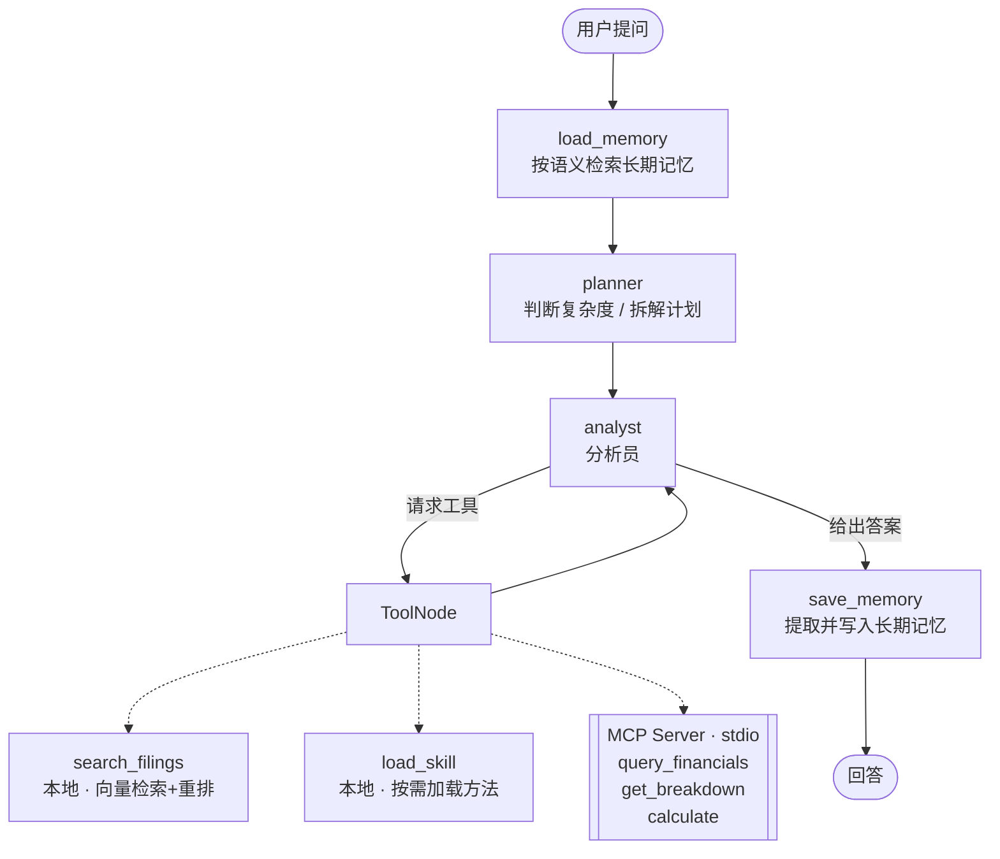
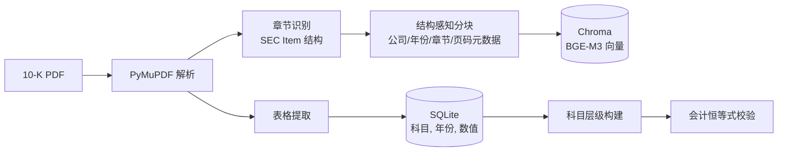

# 财报分析 RAG Agent

面向上市公司 SEC 10-K 年报的智能问答与分析系统。支持数值查询、构成归因、盈利分析与跨公司对比，回答附带章节与页码出处。

当前收录：**Tesla FY2025 10-K、Apple FY2025 10-K**（新增公司只需放入 PDF 并加一行配置）。

---

## 效果示例

**构成归因：汽车业务收入下滑主要是哪个子项拖累的？**

```
[规划] 生成 2 步执行计划
→ 调用 get_breakdown({'parent_item': 'Total automotive revenues'})
→ 调用 calculate({'expressions': '65821-72480; 1993-2763; ...'})
[统计] 本轮共调用工具 2 次

主要拖累项是汽车销售（Automotive sales）：
| 子项     | 2024   | 2025   | 变动额  | 占总降幅 |
| 汽车销售 | 72,480 | 65,821 | -6,659 | 88.3%   |
| 监管积分 | 2,763  | 1,993  | -770   | 10.2%   |
| 汽车租赁 | 1,827  | 1,712  | -115   | 1.5%    |
数据来源：Tesla 10-K，第 64 页
```

**跨公司对比：特斯拉和苹果谁更赚钱？**（自动加载 `peer-comparison` Skill）

```
| 指标       | Tesla FY2025 | Apple FY2025 |
| 毛利率     | 18.03%       | 46.91%       |
| 营业利润率 | 4.59%        | 31.97%       |
| 净利率     | 4.00%        | 26.92%       |
可比性提示：Tesla 财年截至 12 月 31 日，Apple 财年截至 9 月下旬，覆盖期间相差约一个季度。
```

**跨会话记忆：** 第一次会话说"我主要关注特斯拉的能源业务"，重启程序后问"能源业务最近表现如何"——未提公司名，Agent 从长期记忆中召回偏好后直接查询 Tesla。

---

## 系统架构

### Agent 层（LangGraph 状态图）



### 数据层（双通道 RAG）



- **向量通道**：负责解释性文本（风险、业务描述、管理层分析）
- **结构化通道**：负责精确数值，不依赖向量检索"恰好命中"正确的块

---

## 技术亮点

| 模块 | 实现 |
|---|---|
| 结构感知解析 | 基于 SEC 法定 Item 结构识别章节，兼容不同公司排版（全大写 / 首字母大写 + 不间断空格） |
| 表格结构化 | 表格解析为（科目, 年份, 数值）入库，按表内位置构建科目层级，量级过滤处理变动列错位 |
| 会计恒等式校验 | 利用"子项之和 = 汇总项"自动校验解析结果，核心科目准确率 **83.8%** |
| 两段式检索 | BGE-M3 召回 Top-20 → BGE-Reranker 精排 Top-5，章节软加权 |
| 规划与工具 | 规划员分流简单/复杂问题；计算工具支持批量表达式，复杂归因问题工具调用 **9 次 → 2 次** |
| 长短期记忆 | 短期：LangGraph checkpointer；长期：向量检索 + SQLite 双写，语义召回 Top-5 并阈值过滤 |
| MCP | 结构化查询与计算封装为独立 MCP Server；依赖重模型的检索工具保留本地，构成混合架构 |
| Skill | 参照 Agent Skills 规范，目录常驻、正文按需加载（渐进式披露） |

---

## 工程问题与解决

| 问题 | 定位 | 解决 |
|---|---|---|
| 同名科目跨表串台 | 收入表与成本表都有 `Automotive sales` 行，仅按表号限定仍有串台 | 以 `table_id + row_idx` 唯一定位行 |
| 跨公司解析错位 | Apple 表格把变动百分比夹在年份列之间（`416,161 \| 6 \| 391,035`），由 Agent 在回答中标注"同比 +130% 异常"后发现 | 同行年度数值量级相近，剔除小于主值 1/100 的项 |
| 校验的盲区 | 上述错位未被会计恒等式校验发现——父子项同时错位，加总仍成立 | 增加同一科目跨页交叉比对 |
| 章节硬过滤屏蔽证据 | 跨章节问题（风险 × 财务）被锁定在单一章节 | 改为重排阶段软加权，优先但不排除 |
| 框架隐式并发 | ToolNode 并行执行工具，两个线程同时初始化 Chroma 导致崩溃 | 双重检查锁 + 启动预热 |
| 工具调用过多 | 9 次调用中 8 次是逐个表达式计算；规划员本身未压缩步骤 | 计算工具改为批量，定位到瓶颈在工具粒度 |

---

## 评估

| 指标 | 结果 | 说明 |
|---|---|---|
| 核心科目层级准确率 | 83.8% | 营收、成本、毛利、费用、资产负债等高频汇总项 |
| 全库层级准确率 | 57.1% | 失败主要源于财报多级嵌套结构，见已知局限 |
| 复杂归因工具调用 | 9 → 2 次 | 同一问题，答案一致 |
| CAGR 计算稳定性 | 5 / 5 一致 | 同一问题重复五次 |

---

## 项目结构

```
├── agent_main.py        # Agent 入口（推荐）
├── agent.py             # LangGraph 状态图、节点、本地工具、MCP 客户端
├── mcp_server.py        # MCP Server：结构化查询与计算工具
├── test_mcp.py          # MCP Server 独立测试
├── memory.py            # 长期记忆：向量检索 + SQLite
├── skills.py            # Skill 发现与加载
├── skills/
│   ├── profitability-analysis/SKILL.md
│   └── peer-comparison/SKILL.md
├── rag_pipeline.py      # 解析、分块、向量库、重排
├── table_db.py          # 表格结构化、科目层级、恒等式校验
├── main.py              # 固定流程 RAG（基线对照）
├── config.py            # 配置
└── data/                # 财报 PDF
```

---

## 快速开始

```bash
python -m venv venv
venv\Scripts\activate                 # macOS/Linux: source venv/bin/activate
python -m pip install -r requirements.txt

copy .env.example .env                # 填入 DEEPSEEK_API_KEY

python table_db.py                    # 构建结构化数据库并运行校验
python agent_main.py                  # 启动 Agent（首次运行自动构建向量库）
```

交互命令：`/tools` 查看工具来源　`/skills` 查看 Skill　`/memory` 查看长期记忆　`/forget` 清空记忆

新增公司：将 10-K PDF 放入 `data/`，在 `config.py` 的 `DOCUMENTS` 中加一行，删除 `chroma_db/` 后重新运行上述两条命令。

---

## 已知局限与后续计划

- **多级嵌套层级**：资产负债表等多级汇总结构尚未完整建模，全库层级准确率仍有提升空间
- **图表未处理**：仅解析文本与表格，财报中的图表信息未纳入
- **市场范围**：Item 结构识别适用于美国 10-K；A 股年报需另建章节映射
- **后续**：从 SEC EDGAR 自动下载财报的 MCP 工具；多级层级栈建模；检索与生成分离的评测集
